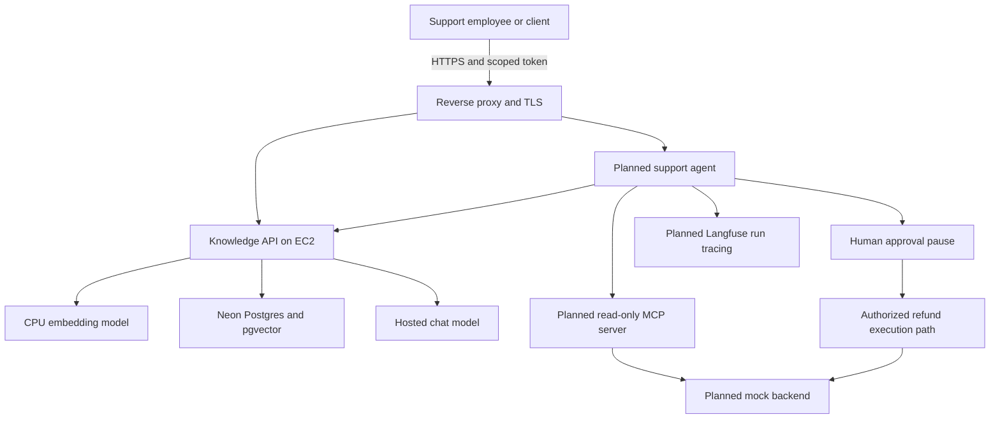

# Support Copilot: what we built, why it exists, and how it works

Updated: **23 October 2026**. Read with the [learning roadmap](LEARNING_ROADMAP.md).

This is a study guide to the real repository and the deployment steps we actually
performed. Commands labelled **historical** explain earlier actions; you do not
need to run them again. Planned components are explicitly marked. No cloud
application deployment, independent mastery, or completed sprint gate is implied.

## Contents

1. [Start with the purpose](#1-start-with-the-purpose)
2. [Where the project stands](#2-where-the-project-stands)
3. [The different computers and terminals](#3-the-different-computers-and-terminals)
4. [The names of the subjects](#4-the-names-of-the-subjects)
5. [Setup and our first health endpoint](#5-setup-and-our-first-health-endpoint)
6. [How documents become searchable](#6-how-documents-become-searchable)
7. [How a question becomes a cited answer](#7-how-a-question-becomes-a-cited-answer)
8. [Authentication and tenant isolation](#8-authentication-and-tenant-isolation)
9. [Tests, evaluations and evidence](#9-tests-evaluations-and-evidence)
10. [Git, GitHub and the green check](#10-git-github-and-the-green-check)
11. [Docker and Compose](#11-docker-and-compose)
12. [AWS, Ubuntu and SSH](#12-aws-ubuntu-and-ssh)
13. [The deployment sequence we performed](#13-the-deployment-sequence-we-performed)
14. [The finished system we are aiming for](#14-the-finished-system-we-are-aiming-for)
15. [How to read the repository](#15-how-to-read-the-repository)
16. [Common confusions and debugging patterns](#16-common-confusions-and-debugging-patterns)
17. [What to study and do next](#17-what-to-study-and-do-next)

## 1. Start with the purpose

A support employee receives a question such as:

> How long is the manufacturing-defect warranty?

We want software to find the correct company policy and return supporting text,
instead of guessing from a language model's general knowledge. Later, the system
will also read a ticket and look up an order. Any refund must pause for human
approval before execution.

The companies and articles are fictional. Northwind Outfitters is the main tenant;
Contoso is the second tenant used to test data separation. A **tenant** is a customer
organization using a shared application. Contoso's credentials must not expose
Northwind's records, even when an attacker asks for them.

The intended services are:

| Service | Responsibility | Current state |
|---|---|---|
| Knowledge API | Ingest policies, search them, return cited evidence | Implemented and verified locally |
| Mock backend | Provide fictional orders, tickets and refund records | Planned |
| Support Agent | Select tools, apply policy, draft replies, pause for approval | Planned |
| MCP server | Expose controlled read-only tools through a standard protocol | Planned |

The mock backend supports the three main services. Installing LangGraph or MCP as
a dependency does not mean their application features have been implemented.

We are doing **AI application engineering**: building software around existing
models. We have not trained or fine-tuned a model.

## 2. Where the project stands

| Completed work | Evidence or qualification |
|---|---|
| Local Python environment and locked dependencies | `pyproject.toml`, `uv.lock`, `.venv` |
| Basic API/container/embedding/model experiments | `hello/`; Langfuse trace input/output confirmed by user |
| Local Postgres with pgvector | Compose DB and integration tests |
| Corpus ingestion | 15 Northwind articles + 3 Contoso articles; 36 baseline chunks |
| Retrieval experiments | 40 answerable + 10 unanswerable synthetic development questions |
| Authenticated API, scope checks, tenant separation | Source and API/database tests |
| Cited answer through an actual model | Saved local Docker smoke result with a warranty quote |
| Automated local tests | Recorded total: 143 passing tests |
| Git commit and GitHub push | User pushed `3d0bd84` |
| GitHub CI | User screenshot shows the `checks` run passed for `3d0bd84` |
| AWS server | User screenshot confirms Running, 3/3 status checks passed |
| SSH and Docker on AWS | User terminal output confirms login and `Hello from Docker!` |
| Source and API image on AWS | Clone reports `3d0bd84`; image build succeeded |

**Current boundary:** an API image exists on EC2. The actual Knowledge API has not
yet been started there with its hosted database and model configuration. We have
not verified a public HTTPS answer. Neon application schema/corpus setup is still
awaiting inspection. Refund approvals, agent flows and MCP tools remain planned.

The test counts and resource details above are historical evidence, not a fresh
claim that every service is running right now. The user's learning checks remain
deferred. Assistant-written code and guided commands are not evidence of independent
ability; the roadmap supplies practice to develop that ability.

## 3. The different computers and terminals

This is the most useful distinction to understand before learning more commands.

| Place | What it is | What ran there |
|---|---|---|
| Windows laptop | Your local development computer | VS Code, PowerShell, Git, Python, Docker Desktop |
| Local Linux containers | Isolated processes managed by Docker Desktop using Linux/WSL2 | Local API and Postgres |
| GitHub repository | Hosted source-code history | Your pushed commit and workflow definition |
| GitHub Actions runner | A temporary Ubuntu machine provided for a workflow job | Dependency install, lint, tests, image build |
| AWS EC2 instance | Your persistent remote virtual machine | Ubuntu, Docker, cloned source, built image |
| Neon | Managed remote Postgres service | Target database; application preparation pending |
| Groq | Hosted model-inference service | The successful local API's chat-model request |
| Langfuse | Observability service | Day 0 sample trace; complete agent tracing is planned |

```text
LAPTOP                  GITHUB                          AWS EC2
edit files --git push--> repository --git clone--------> source files
                             |
                             +--> temporary CI runner
                                  runs checks, then exits

LAPTOP --SSH encrypted connection---------------------> Ubuntu shell
```

The GitHub runner and EC2 are separate machines. CI succeeding does not install
anything on EC2 in our present workflow.

### Recognize your prompt

```text
(support-copilot) PS G:\support-copilot>
```

This is Windows PowerShell on your laptop. The prefix indicates a Python virtual
environment is active. It does not mean you are inside Docker or inside AWS.

```text
ubuntu@ip-...:~/support-copilot$
```

This is the remote Ubuntu shell reached through SSH. `ubuntu` is the login user,
`~` means that user's home directory, and `$` marks an ordinary shell prompt.

The VS Code terminal panel can display either shell. **The panel is the window;
the shell and connection determine where commands execute.** Closing SSH does not
stop the EC2 machine. The server continues consuming resources until stopped or
terminated through AWS.

`localhost` also depends on the machine: localhost on your laptop means the laptop;
localhost inside a container means that container; localhost on EC2 means EC2.

## 4. The names of the subjects

| What you saw | Official subject to study |
|---|---|
| `cd`, paths, shell prompts, `sudo`, permissions | Command-line tools, Linux fundamentals, operating systems |
| Python functions, modules, interfaces and exceptions | Python programming and software design |
| `.venv`, `uv`, installed packages, lock file | Python environment and dependency management |
| URLs, ports, JSON, `/health`, requests | Computer networking, HTTP, backend API development |
| Tables, SQL, transactions, database connections | Relational databases and PostgreSQL |
| Embeddings, chunks, vector search | Information retrieval and semantic search |
| Search followed by model-supported answering | Retrieval-augmented generation (RAG) |
| Tokens, scopes, tenant filters | Authentication, authorization and multi-tenant application security |
| Git add/commit/push/clone | Version control and collaborative development |
| Green GitHub workflow result | Continuous integration (CI) using GitHub Actions |
| Dockerfile, image, container and Compose | Containerization and container orchestration at a small scale |
| EC2, AMI, security groups, EBS and SSH | Cloud infrastructure and deployment operations |
| Logs, traces, health, readiness, debugging | Observability and reliability engineering |
| Tool calls, LangGraph, approval pauses | Agentic application engineering and workflow orchestration |
| MCP tools/resources/prompts | Model Context Protocol and tool integration |

**DevOps** is the broader practice of making development and operations work
together through feedback, shared responsibility and automation. It is not the
name of one tool, and it is not necessary to learn every DevOps technology for
this project. CI/CD is one relevant area inside that broader work.

## 5. Setup and our first health endpoint

### Why Python, a virtual environment and uv?

Python executes application code. Libraries provide capabilities such as HTTP
routing, validation and database access. A virtual environment isolates a project's
Python packages from unrelated projects and the system installation.

`uv` manages dependencies and runs commands in that project environment. Our
`pyproject.toml` declares the project and dependencies; `uv.lock` records resolved
versions; `.venv` contains installed executable files and packages. We commit the
declaration and lock file, not the installed environment. See the
[uv project guide](https://docs.astral.sh/uv/guides/projects/).

Historical local command:

```powershell
uv sync --frozen --cache-dir G:\uv-cache
```

| Part | Meaning |
|---|---|
| `uv sync` | Make the installed environment match the project dependencies |
| `--frozen` | Use the existing lock file without updating it |
| `--cache-dir` | Store package downloads/build cache on G: |

Freezing dependencies improves repeatability; it does not make base images,
external APIs or model behavior immutable. Libraries installed for later phases
may be unused by today's API.

### Why FastAPI, Uvicorn and Pydantic?

FastAPI defines what HTTP routes do. Uvicorn runs the server process, listens on
a port and passes requests into the application. Pydantic validates structured
data, including incoming request bodies and selected model output.

This complete small example illustrates the first health endpoint:

```python
from fastapi import FastAPI

app = FastAPI()

@app.get("/health")
def health():
    return {"status": "ok"}
```

`@app.get` registers a handler for HTTP GET at `/health`. The return value becomes
a JSON response. Starting Uvicorn is a separate action from defining the function.
The actual API now lives in `src/support_copilot/knowledge_api.py`; `hello/health_app`
was the earlier experiment. The [FastAPI tutorial](https://fastapi.tiangolo.com/tutorial/)
is the reference for framework usage.

### What is a port?

An IP address identifies a network endpoint; a port identifies a listening service
at that endpoint. For example, `http://localhost:8001/health` names the machine,
port and route to call. An endpoint is commonly described by its HTTP method and
path, such as `GET /health`. HTTP carries requests and responses; JSON is a data
format inside many of those messages. See [HTTP overview](https://developer.mozilla.org/en-US/docs/Web/HTTP/Guides/Overview).

### Earlier setup experiments and what they proved

Before the full API, we ran a local `/health` service and packaged it in Docker.
That established that HTTP serving and basic containers worked. We also compared
real embedding similarity and tried one simple Ollama tool call. The local model
could request a tool, but sometimes leaked thinking text despite the requested
setting. This motivated defensive parsing and later use of a hosted model; it
was not a complete agent evaluation. Model and embedding caches were put on G:
because C: space was limited, and the laptop's low free RAM constrained inference.

A Langfuse test trace was sent; the user found its input and output in the UI.
That verified the account/SDK setup, not full application tracing. The user also
reported Neon's vector extension as 0.8.6. Extension availability does not establish
that the application tables, tenants, corpus or token hashes have been installed.

The later work proceeded from database/retrieval foundation (Day 1), through
corpus ingestion (Day 2), retrieval experiments (Day 3), API/auth/Docker/CI (Day 4),
and the current incomplete deployment (Day 5). These are dependency milestones,
not a claim that the original calendar or learning gates were completed on time.

## 6. How documents become searchable

Our ingestion code turns Markdown articles into searchable database rows.

```text
Markdown articles
      ↓ validate titles, file names and content
Character chunks with overlap
      ↓ add article title to each embedding input
FastEmbed model on CPU
      ↓ 384 numbers per chunk
Postgres: tenant + document + original text + vector + model name
```

### 6.1 Articles and chunks

An article may contain more text than is useful in one search result. **Chunking**
splits it into windows. Overlap repeats part of the previous window so a relevant
sentence near a boundary has a better chance of remaining together.

Our baseline uses **800 characters with 120-character overlap**, not 800 tokens.
The window advances by 680 characters. A token is a model's text-processing unit;
it is not generally the same as a character or word.

Example using smaller numbers for readability:

```python
from support_copilot.chunking import chunk_text

chunks = chunk_text("abcdefghijkl", chunk_size=6, overlap=2)
print([chunk.text for chunk in chunks])
# ['abcdef', 'efghij', 'ijkl']
```

The implementation preserves source text and offsets. It may split words; that is
an intentional simple baseline, not a claim of ideal natural-language segmentation.

### 6.2 Embeddings

An embedding model maps text to a list of numbers. Semantically related texts tend
to have vectors near each other under an appropriate similarity measure. That
helps find "returns" policies when a question says "send my jacket back".

Our adapter uses FastEmbed with `BAAI/bge-small-en-v1.5`, producing 384-dimensional
vectors on CPU. It validates dimension, finite values and nonzero magnitude. It
loads the model lazily so importing code or using fake-based tests need not load
weights. [FastEmbed documentation](https://qdrant.github.io/fastembed/) explains the
library; the configuration and adapter determine this project's exact usage.

The embedding model and the chat model do different jobs. FastEmbed produces
search vectors. Ollama/qwen3 or Groq's hosted model provides language-model output.
We did not use the chat model to create this corpus's embeddings.

### 6.3 PostgreSQL and pgvector

Postgres stores structured data in tables. pgvector adds vector storage and
similarity-search operators. A dedicated vector database is not required for this
small project. In our schema:

| Table | Stores |
|---|---|
| `tenants` | Organization identities |
| `api_tokens` | Token hashes, scopes, expiry and revocation metadata |
| `documents` | Article identity, title and source per tenant |
| `chunks` | Original text, vector, article link, position and embedding model |

Composite keys include `tenant_id`, and chunk/document foreign keys include the
tenant. Parameterized application queries also filter by tenant. We have not
implemented Postgres row-level security. Database credentials must stay with
trusted operators and services, not API callers.

When replacing supplied documents, the importer uses transactions: a failure rolls
back the batch instead of leaving half an import. Deterministic ids and replacement
make repeated imports avoid duplicates. This is **idempotent ingestion**. It does
not automatically delete articles missing from a later directory scan.

References: [Postgres tutorial](https://www.postgresql.org/docs/16/tutorial.html),
[pgvector README](https://github.com/pgvector/pgvector), and our `schema.sql`.

### 6.4 Local Postgres versus Neon

Locally, Postgres runs in Docker and its data persists in a named volume. Neon is
the hosted Postgres provider selected for deployment. The application can use
either through its configured `DATABASE_URL`; the database server is a separate
service from the API container. [Neon introduction](https://neon.com/docs/introduction).

Our existing `NEON_DATABASE_URL` setting is not automatically used as the local
database URL. This separation prevents an ordinary local command from silently
targeting the hosted database. The current Neon application schema/data must still
be inspected and prepared; a previously verified pgvector extension alone is not
the complete application database.

## 7. How a question becomes a cited answer

Consider `How long is the manufacturing defect warranty?`.

```text
POST /v1/ask with query + bearer token
             ↓
Validate request and authenticate token
             ↓
Get tenant and permitted scopes
             ↓
Embed question with the same embedding model
             ↓
Search only that tenant's chunks
             ↓
Filter retrieved evidence by provisional score threshold
             ↓
Model selects supporting chunk ids and exact quotations
             ↓
Code validates the selected ids and quote text
             ↓
Return original source quotations + citations, or refuse
```

This is our form of **retrieval-augmented generation (RAG)**. Retrieval supplies
relevant source material at request time; it does not retrain the model. Our first
answering implementation is deliberately extractive: it returns verified source
quotations rather than unrestricted model prose.

### Search and similarity

The store orders candidate chunks using cosine distance, then reports similarity
as one minus distance. Lower distance corresponds to higher similarity. A score
such as 0.8 is not an 80% probability that the answer is correct.

The database query uses bound parameters rather than string-concatenating a
question, tenant id or vector into SQL. It joins article metadata using both
document and tenant identity. `top_k=5` means return up to five ranked chunks;
it does not mean five independently verified facts.

### Answer validation

From the actual answer selector:

```python
evidence = [hit for hit in hits if hit["score"] >= threshold]
if not evidence:
    return refusal("no_evidence")
```

After a model reply, code checks the JSON shape, requires an allowed chunk id,
and matches each selected quotation to the supplied source. It permits whitespace
formatting differences but returns the matched original text. Invented words,
foreign chunk ids or unsupported quotations are rejected.

This proves source membership, not that the selected quotation fully answers the
question. Relevant-looking text can still be insufficient. Full answer-quality
evaluation remains unfinished.

The API conservatively refuses concrete order references with
`record_lookup_required`: policy articles cannot reveal when an actual order's
refund was approved. The future agent needs an authenticated order lookup tool.

### What we observed with the real model

The saved local smoke run returned the original sentence about a one-year warranty
and cited `warranty.md`. That run used Groq's `openai/gpt-oss-20b` because the laptop
had little free RAM. Local Ollama with `qwen3:4b` remains another adapter configuration.
The provider-compatible JSON format does not mean the request was sent to OpenAI;
the configured hosted endpoint in this run belonged to Groq.

Model availability, rate limits and free-tier policies can change. The saved run
establishes one success with that configuration, not unlimited ongoing access.

### The API's routes

| Route | Access | Responsibility |
|---|---|---|
| `GET /health` | Public | Confirm the application process responds |
| `GET /ready` | Public | Check database schema access and embedding availability |
| `POST /v1/search` | `kb:read` | Return tenant-filtered source chunks |
| `POST /v1/ask` | `kb:read` | Select and validate cited answer evidence |
| `POST /v1/ingest` | `kb:write` | Replace supplied tenant documents |

Example request body, with no credentials included:

```json
{"query": "How long is the manufacturing defect warranty?", "top_k": 5}
```

`/docs` presents the OpenAPI-based interactive API documentation. It is a client
for calling routes, not a separate AI engine. Readiness currently does not make
a live chat-model request, so `/ready` success does not prove Groq quota is available.

## 8. Authentication and tenant isolation

**Authentication** establishes which credential the caller holds. **Authorization**
decides which operations that credential permits. A scope is a named permission,
such as `kb:read` or `kb:write`.

Our flow is:

```text
Caller supplies secret token in Authorization header
          ↓
Code hashes token and looks up its stored hash
          ↓
Reject missing, malformed, expired or revoked credentials
          ↓
Read tenant + scopes from database record
          ↓
Require scope, then query only that tenant
```

The caller cannot choose another tenant by adding a `tenant_id` field. Request
models reject unexpected fields. In this initial design, SHA-256 hashes are used
for high-entropy generated API tokens; this is not a recommendation to store human
passwords using plain SHA-256. Password storage is a different security topic.

### Different credentials protect different boundaries

| Credential | Purpose |
|---|---|
| SSH private `.pem` key | Log into the Ubuntu server |
| Knowledge API token | Access one tenant's permitted API operations |
| Groq API key | Authenticate the service to hosted model inference |
| Postgres connection credentials | Connect a trusted service/operator to the DB |
| AWS IAM credentials/role | Authorize AWS API and infrastructure operations |

These are not interchangeable. An SSH key does not authenticate a Knowledge API
request. Knowing the public IP is not knowing any of these credentials.

The ignored `.env` holds local configuration and secrets. `.env.example` documents
names and safe defaults. A program usually reads environment settings at startup;
changing a file need not change an already running process. The cloud instance
does not receive local `.env` values through `git clone` or our Docker image.

`.gitignore` limits ordinary Git inclusion; `.dockerignore` limits the Docker build
context. They serve different tools. Ignore rules are not a substitute for checking
what is staged, and do not automatically remove secrets already committed.

## 9. Tests, evaluations and evidence

### Tests versus evaluations

| Check | What question it answers | Example in this project |
|---|---|---|
| Unit test | Does one function satisfy a defined contract? | Overlap and invalid chunk sizes |
| Integration test | Do components work together? | Real Postgres with tenant-aware ingestion |
| API/security test | Does a request obey validation and permissions? | Reject revoked token or foreign-tenant data |
| Smoke check | Does a small real path work in a running system? | Actual model produces a valid warranty citation |
| Evaluation | How well does retrieval/answering perform on a dataset? | Recall@5 and MRR over development questions |

`pytest` runs assertions and reports results. Fixtures provide repeatable setup;
fake models return controlled outputs without a network request. Our integration
tests use a separate local `copilot_test` database and roll back data. They refuse
remote test database targets. No hosted model key is required by the CI test suite.

Ruff **linting** detects configured code issues. Ruff **formatting** checks layout.
Neither proves application correctness. Tests check selected behavior; they do not
prove that every possible production input is safe.

### Retrieval results and their limits

The saved Day 3 dataset contains 40 answerable and 10 unanswerable questions. All
five configurations achieved Recall@5 of 1.000 on this synthetic development set.
Baseline MRR@5 was 0.950; larger chunks reached 1.000. Baseline chunks remain the
operating setting because better retrieval rank alone did not prove better refusal
or answer behavior.

**Recall@5**, as used here, is the fraction of questions whose expected article
appears among the first five chunk results. **MRR@5** averages the reciprocal rank
of the first matching chunk, treating no match in five as zero. A first result
contributes 1; a second result contributes 1/2.

The score gate rejected 9 of 10 unanswerable questions in the development analysis,
but an actual refund-date question still scored above the cutoff. These measurements
did not invoke the answering model. Do not call that a 90% deployed API refusal
rate. Labels and thresholds were developed on the same synthetic set; no independent
or held-out generalization result is claimed.

Evidence: [retrieval results](../evals/results/day-03-retrieval.md),
[real local API smoke](../evals/results/day-04-api-smoke.json),
[technical journal](journal/day-04.md), and the `tests/` directory.

## 10. Git, GitHub and the green check

### 10.1 Version control: how the code moved

Git tracks source history. GitHub hosts a remote Git repository and provides
services such as Actions. We used this historical sequence on the laptop:

```powershell
git add .
git diff --cached --stat
git commit -m "Build tenant-isolated Knowledge API with tests and Docker"
git push origin main
```

| Command | Effect |
|---|---|
| `git add .` | Stage current changes under the current directory, respecting applicable ignore rules |
| `git diff --cached --stat` | Summarize what is staged for the next commit |
| `git commit` | Create a local history snapshot from staged changes |
| `git push origin main` | Send local main history to the GitHub remote named origin |

Commit `3d0bd84` records the implementation pushed by the user. Its short id lets
us relate the local revision, CI run and cloned source. A short Docker tag matching
the commit is a human naming convention; Docker does not validate that association.

On EC2, `git clone` downloaded the repository. `git rev-parse --short HEAD` printed
`3d0bd84`, confirming the checked-out revision at that moment. A later push does not
automatically update this checkout or rebuild its image.

Reference: [Pro Git](https://git-scm.com/book/en/v2).

### 10.2 Is the GitHub check CI/CD?

**Yes: our green check is CI, implemented with GitHub Actions.**

| Name | Meaning | Current implementation |
|---|---|---|
| Continuous integration (CI) | Automatically build/check/test changes as they are integrated | Implemented |
| Continuous delivery | Keep validated releases ready to deploy through a repeatable process; release may require approval | Our build checks are a foundation; no complete delivery pipeline |
| Continuous deployment | Automatically deploy passing changes to an environment without a manual release decision | Not implemented |

GitHub Actions can implement CI and deployment automation, but our current workflow
does not SSH into EC2, publish a release image, provision resources or start the
production application. We are performing manual deployment after CI.
See [GitHub's Actions concepts](https://docs.github.com/en/actions/get-started/understand-github-actions).

### 10.3 Read our workflow as instructions to another computer

The actual file is [`.github/workflows/ci.yml`](../.github/workflows/ci.yml).

```yaml
name: checks

on:
  push:
  pull_request:

permissions:
  contents: read

jobs:
  python:
    runs-on: ubuntu-latest
```

| Workflow term | Meaning in our repository |
|---|---|
| Workflow | The automation described by this YAML file |
| Event/trigger | A push or pull-request event starts a run |
| Run | One execution, such as the run for `3d0bd84` |
| Job | The group of work named `python` |
| Runner | GitHub's temporary `ubuntu-latest` execution machine |
| Step | One checkout/setup/command operation inside the job |
| Action | Reusable automation invoked with `uses:` |
| Service container | The temporary Postgres+pgvector used by integration tests |
| Exit code | Conventionally zero means command success; nonzero indicates failure |
| Check result | GitHub's reported status for that execution |

Our job performs these operations in order:

1. Check out the repository so the runner has source files.
2. Set up Python 3.12 and uv 0.13.0. The uv setup action is pinned to a commit.
3. Run `uv sync --frozen` to install locked runtime and development dependencies.
4. Run Ruff lint on source, tests, scripts and retrieval utilities.
5. Check formatting without rewriting files.
6. Run pytest with the temporary local Postgres service.
7. Build the Knowledge API image using its service Dockerfile.

The local demo DB password in this job is disposable test configuration, not the
Neon deployment password. The workflow does not need cloud secrets to test the code.
It creates an image inside that temporary runner but has no step to push it to an
image registry or retain it as a release artifact. That is why we built an image
again on EC2. We have not configured a full artifact-promotion pipeline.

### 10.4 What the green check establishes

The user screenshot shows the `checks` workflow succeeded for `3d0bd84`. That is
evidence the defined job completed on GitHub. It is not evidence that the cloud API
is running, the model quota is available, or every answer is correct. A green
workflow also does not by itself configure branch protection or require checks
before merging.

In a more developed pipeline, you could build an image once, push an immutable
digest to a registry, approve the release, deploy it and smoke-test the environment.
Those are future **artifact management, release automation and deployment pipeline**
topics, not steps we have already implemented.

## 11. Docker and Compose

### 11.1 Why Docker exists here

Our code needs Python and particular dependencies. Docker packages the required
runtime filesystem and startup configuration so another host can run it with fewer
manual installation differences. A container is an isolated process environment
using the host's kernel; it is not normally a separate full virtual machine.
Reference: [Docker getting started](https://docs.docker.com/get-started/).

```text
Dockerfile + source + dependency lock
                   ↓ docker build
                image
                   ↓ docker run / compose up
             running container
```

| Term | Meaning here |
|---|---|
| Docker Engine | Server software that manages images and containers |
| Docker CLI | The `docker` client that talks to that engine |
| Docker Desktop | Laptop product that supplies Docker integration, using Linux/WSL2 here |
| Dockerfile | Build instructions for an image |
| Build context | Files the builder is allowed to use, reduced by `.dockerignore` |
| Image | Packaged runtime filesystem layers and configuration |
| Tag | A mutable name for an image, such as `support-copilot-knowledge:3d0bd84` |
| Container | A created/running instance of an image with its own lifecycle |
| Registry | A service for storing/distributing images, such as Docker Hub |
| Volume | Storage managed separately from a container's writable filesystem |
| Compose | A YAML-based way to define and start related services |

### 11.2 Read the Dockerfile by purpose

Our [Dockerfile](../services/knowledge-api/Dockerfile) uses two build stages:

| Instructions | Purpose |
|---|---|
| `FROM python:3.12-slim AS builder` | Start with a Python Linux base |
| Copy uv from its image | Obtain the dependency installer |
| `WORKDIR /app` | Use `/app` for following relative paths |
| Copy `pyproject.toml` and `uv.lock` first | Let dependency work be reused when only application code changes |
| First `uv sync` | Install runtime dependencies without installing the project yet |
| Copy `src`, then second sync | Install our Python package as well |
| Second `FROM` | Begin the smaller runtime stage |
| Create user/cache directory | Prepare unprivileged execution and writable model cache |
| Copy `.venv` and articles | Include runtime packages and fictional source data |
| `ENV` | Set default runtime configuration |
| `USER app` | Run as an unprivileged user inside the container |
| `EXPOSE 8000` | Document the intended container port; does not publish it |
| `CMD [...]` | Default command when the container starts: run Uvicorn |

`RUN` executes during a build. `CMD` records what to execute when a container is
started. Building successfully therefore does not imply Uvicorn has started.
The final stage excludes `.env`, Git history and tests. Docker's builder may still
retain intermediate layers/caches outside the final image.

### 11.3 The exact EC2 build command

Historical command, run in Ubuntu at `~/support-copilot`:

```bash
sudo docker build -f services/knowledge-api/Dockerfile -t support-copilot-knowledge:3d0bd84 .
```

| Part | Meaning |
|---|---|
| `sudo` | Run the Docker client with elevated privileges on this Ubuntu host |
| `docker build` | Ask Docker to build an image |
| `-f ...` | Select the Dockerfile inside the service directory |
| `-t ...:3d0bd84` | Assign a name and revision tag |
| final `.` | Use the current project directory as build context |

The supplied build output ended with image id `04d288243eea` and the successful tag.
It included a legacy-builder deprecation warning; the actual build succeeded.
Learning BuildKit/buildx is useful later, but that warning did not mean the image
was unusable.

### 11.4 Local Compose does more than the default image

Our local `compose.yaml` defines the API plus Postgres. Its API command runs
`copilot seed-corpus` before Uvicorn; this initializes schema/tenants and seeds
only empty tenant corpora. The Dockerfile's default `CMD` starts Uvicorn alone.
Do not assume a bare cloud container has performed local Compose's initialization.

Local mapping `127.0.0.1:8001:8000` means laptop port 8001 forwards to API container
port 8000, accessible on laptop loopback. The local DB uses loopback port 5432.
Named volumes preserve DB data and downloaded embedding weights across ordinary
container recreation. Deleting the volumes is a separate, data-destructive action.

The container's `db` hostname resolves inside the Compose network; it is not the
Neon hostname. `host.docker.internal` is used for reaching laptop-hosted Ollama.
Our local Compose file contains public demo DB credentials and is not the cloud
configuration to expose to the internet.

## 12. AWS, Ubuntu and SSH

### 12.1 The cloud components we selected

| Component | Meaning | Our observed selection |
|---|---|---|
| AWS account plan | Controls account access/billing conditions | Free plan, shown in user screenshot |
| Credit balance | Allowance consumed by eligible usage | $100 at time of screenshot |
| Region | AWS geographical deployment area | Sydney, `ap-southeast-2` |
| EC2 | AWS virtual-server service | One instance |
| AMI | Machine image used to start its operating system | Ubuntu Server 24.04 LTS, x86 |
| Instance type | CPU/memory resource shape | `t3.small`: 2 vCPUs, 2 GiB RAM |
| EBS volume | Persistent disk attached to the VM | One 20 GiB gp3 volume |
| Public IP | Network address used to reach the instance | Assigned at launch; may change after stop/start |
| VPC/subnet | AWS network and a subdivision of it | Default network/subnet selection |
| Security group | Stateful instance-network firewall | SSH from My IP; inbound HTTP/HTTPS not opened |
| Key pair | Public/private key used for SSH login | `support-copilot-key` |

The Free plan screenshot showed 14 April 2027 as the expiry date. Credits can run
out earlier. A credit-backed plan is not unlimited free computing. Instance runtime,
storage and applicable public network resources consume allowance. Stopping EC2
does not delete its EBS disk. Recheck current account information before creating
or leaving resources running; do not upgrade the account for this project.

Official references: [EC2 concepts](https://docs.aws.amazon.com/AWSEC2/latest/UserGuide/concepts.html),
[T3 specifications](https://aws.amazon.com/ec2/instance-types/t3/),
[Free Tier FAQ](https://aws.amazon.com/free/free-tier-faqs/).

### 12.2 Why Ubuntu?

EC2 is the virtual hardware service; Ubuntu is the operating system installed on
that hardware. Our application still runs Python inside Docker. Docker Engine on
Ubuntu runs those containers; a local Windows Python virtual environment is not
copied to the server. Our Linux image has its own installed environment.

### 12.3 Why SSH and a .pem key?

SSH provides an encrypted remote terminal. The private key proves possession of
the authorized credential; the corresponding public key was made available to
the instance during launch. The private key remains on the laptop.

Historical local command:

```powershell
ssh -i "$env:USERPROFILE\Downloads\support-copilot-key.pem" ubuntu@13.210.138.248
```

The address is historical and may change; use the instance's current public IP
for future sessions. `-i` selects the private identity file. `ubuntu@...` specifies
the remote OS username and server. The first connection asked about the server's
host-key fingerprint. Server host identity and your login key are separate keys;
for future deployments, compare the host fingerprint with a trusted AWS source
before accepting a new server identity.

Windows OpenSSH initially refused because another local group could access the
private file. We restricted the file's access-control list (ACL): grant the local
user read access, disable inherited permissions and remove that group's access.
The later successful login is evidence of the fix. This was a laptop permissions
problem, not a broken Ubuntu password or failed Docker install.

### 12.4 Security group versus key permissions

The security group determines which network connections can reach SSH. My IP
restricted port 22 to the user's public address at configuration time. The `.pem`
file's Windows ACL controls who can read the credential locally. Both matter at
different boundaries. If the user's public IP changes, the SSH security-group
rule may need updating; repeatedly changing key permissions would not fix that.

IAM/MFA setup and least-privilege cloud roles are deployment requirements to learn
and verify. The screenshots shared so far do not establish that those tasks were
completed. We have not configured Parameter Store secrets or a production role.

## 13. The deployment sequence we performed

This records the completed sequence, not a command list to blindly repeat.

| Step | Location | Action and reason | What the result establishes |
|---|---|---|---|
| 1 | Browser/AWS | Confirm Free plan and credits | Account plan was visible; no upgrade required |
| 2 | Browser/AWS | Choose Ubuntu, t3.small, disk and network rules | A small server with restricted SSH was configured |
| 3 | Browser/AWS | Launch one EC2 instance | VM created; resource consumption begins |
| 4 | Browser/AWS | Wait for 3/3 status checks | Infrastructure checks passed; not an API health test |
| 5 | Laptop PowerShell | Connect with SSH key | An encrypted Ubuntu session became available |
| 6 | Laptop PowerShell | Fix private-key ACL when SSH refused it | Credential became acceptable to Windows OpenSSH |
| 7 | Ubuntu | Update package index; install Docker, Compose and Git | Server gained tools needed for containers/source |
| 8 | Ubuntu | Start/enable Docker; run hello-world | Docker could download and execute a test image |
| 9 | Laptop | Review staged files for secrets and commit | Implementation was captured as `3d0bd84` |
| 10 | Laptop/GitHub | Push main | Repository and workflow became available remotely |
| 11 | GitHub runner | Run workflow | User screenshot confirms the checks passed |
| 12 | Ubuntu | Clone repository and inspect HEAD | Server checkout matched tested revision |
| 13 | Ubuntu | Build service Dockerfile | API image was created; application not yet launched |
| 14 | Neon dashboard | Inspect selected DB, extension and existing tables | **Requested; results not yet supplied** |

Historical Ubuntu setup:

```bash
sudo apt-get update
sudo apt-get install -y docker.io docker-compose-v2 git
sudo systemctl enable --now docker
sudo docker compose version
sudo docker run --rm hello-world
```

`apt-get update` refreshes package indexes, not every installed package.
`install` installs the named tools. `systemctl enable --now` both starts the daemon
and arranges startup at boot. `hello-world` downloads and runs a tiny test image;
its success says nothing about our API's database credentials. The observed Compose
version was `2.40.3+ds1-0ubuntu1~24.04.1`. We used Ubuntu's Docker packages, not a
second Docker Desktop installation on the server.

The earlier Docker error on the laptop happened because `docker build ... .`
looked for `Dockerfile` in the wrong directory. The subsequent image-pull error
followed from the build failure. This teaches two habits: verify your working
directory, and diagnose the first failure before the errors it causes.

## 14. The finished system we are aiming for

The following diagram is a **target**, not the current deployment:



The read-only MCP server must not become a route around refund approval. The
approved execution path is a separate controlled operation. A model's suggestion
to refund is not permission to execute a refund.

### Work still needed for Knowledge API deployment

1. Inspect the intended Neon database; prepare schema, fictional corpus and token hashes.
2. Configure hosted DB/model credentials securely, with an appropriate AWS access model.
3. Start the API container with the right environment, cache, limits and recovery settings.
4. Establish HTTPS before sending API credentials over a public connection.
5. Check readiness, auth, tenant behavior and a real cited answer on the deployment.
6. Verify restart recovery, resource usage and rollback instructions.
7. Complete remaining retrieval/answer refusal checks and accurately review Gate G1.

### Future Support Agent

The agent will repeatedly select and call permitted tools, inspect the results and
decide its next step. We will first understand a bounded loop, then use LangGraph
to represent state and transitions. A deterministic policy check must enforce
refund rules; a durable approval interrupt must survive a process restart.
None of those flows is implemented yet. [LangGraph overview](https://docs.langchain.com/oss/python/langgraph/overview).

### Future MCP server

MCP standardizes how an AI application's client discovers and calls server-provided
tools and accesses resources/prompts. It does not supply a model, guarantee secure
tool implementations, or replace tenant checks. Our planned server provides scoped
read-only access; we still need schema, transport, authorization and isolation tests.
[MCP introduction](https://modelcontextprotocol.io/docs/getting-started/intro).

### Observability

Logs record application events. Traces relate operations within a request/run, so
you can identify whether retrieval, inference or another operation failed. Langfuse
was checked with one setup trace; that is different from instrumenting the complete
future agent. Current API request logs include request ids, status and duration;
they avoid storing authorization headers or full prompts.
[Langfuse observability](https://langfuse.com/docs/observability/overview).

## 15. How to read the repository

Follow the data flow rather than opening every file at once.

| Read | What to look for |
|---|---|
| `data/northwind/warranty.md` | The original fact used in the real answer |
| `src/support_copilot/chunking.py` | How text windows preserve original content |
| `src/support_copilot/embeddings.py` | The model interface, lazy loading and validation |
| `src/support_copilot/schema.sql` | Where text, tenant ids and vectors live |
| `src/support_copilot/ingestion.py` | How articles become transactionally stored chunks |
| `src/support_copilot/database.py` | Tenant filters, joins and vector ordering |
| `src/support_copilot/auth.py` | How a token resolves to a principal and scopes |
| `src/support_copilot/answering.py` | Refusal logic and source-quote validation |
| `src/support_copilot/chat.py` | Bounded HTTP calls to local/hosted model endpoints |
| `src/support_copilot/knowledge_api.py` | Routes, dependencies, validation and errors |
| `src/support_copilot/bootstrap.py`, `cli.py` | Trusted operator initialization and ingestion commands |
| `tests/` | The expected behavior, including failure paths |
| `.github/workflows/ci.yml` | How another machine verifies the repository |
| `services/knowledge-api/Dockerfile` | How the runtime is packaged |
| `compose.yaml` | How local API and DB start together |
| `scripts/smoke_knowledge.py` | How a running system is checked through HTTP |
| `evals/retrieval/` | Dataset definitions, experiments and evaluation methodology |

Versions recorded by the implementation include Python 3.12.15, uv 0.13.0,
FastAPI 0.143.3, Uvicorn 0.54.0, Pydantic 2.14.1, FastEmbed 0.9.0, psycopg 3.3.6,
pgvector Python adapter 0.5.1 and Langfuse Python SDK 5.0.4. The Python adapter's
version is distinct from the Postgres vector extension version. `uv.lock` is the
source for resolved package versions; old videos may demonstrate different APIs.

## 16. Common confusions and debugging patterns

| Observation | Likely boundary to inspect |
|---|---|
| Dockerfile not found | Current directory, `-f` path and build context |
| Image built but URL fails | Whether a container/server actually started and published a port |
| EC2 Running but API fails | VM health is separate from application health |
| SSH timeout | Instance/IP, network path, security-group source address |
| SSH says unprotected private key | Local key file ACL, before remote authentication |
| API 401 | Credential/header validity |
| API 403 | Authenticated credential lacks permission |
| API 422 | Request fields/types/limits |
| API 503 | Dependency unavailable; inspect safe status/log evidence |
| CI green but public endpoint fails | Runtime configuration and deployed dependencies |
| Local success but CI failure | Missing dependency, environment assumption, test isolation or platform difference |
| Score high but answer absent | Similarity is relatedness, not factual sufficiency |

A useful debugging routine is: identify the machine, identify the first failing
operation, reproduce a small case, inspect the relevant boundary, change one thing,
and repeat the check. Do not solve a network timeout by changing prompts or solve
a tenant filter bug by asking the model to be more careful.

## 17. What to study and do next

For understanding, start with sections **1–4**, then **10**. You do not need to
understand every Python file before you can understand the development/deployment
journey. Use [LEARNING_ROADMAP.md](LEARNING_ROADMAP.md) for exercises and resources.

For resuming implementation, the next operational task remains the read-only Neon
inspection in its SQL Editor. These are not required just to read this guide:

```sql
SELECT current_database();
SELECT extversion FROM pg_extension WHERE extname = 'vector';
SELECT table_name
FROM information_schema.tables
WHERE table_schema = 'public'
ORDER BY table_name;
```

We paused deployment to create this explanation. No additional cloud resource,
schema migration, secret transfer or deployment was performed as part of writing it.
