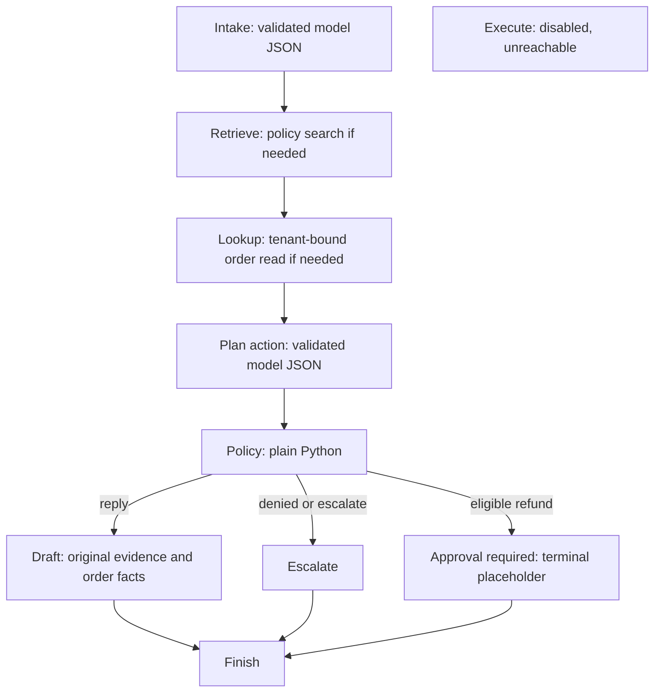

# Day 8: the support agent as a graph

Implemented with installed LangGraph **1.2.16**. Checked the installed signatures
and [official Graph API guide](https://docs.langchain.com/oss/python/langgraph/graph-api).
Nodes return state updates; conditional edges choose the next node. This replaces
the orchestration, not tenant authorization or code-enforced refund policy.

## Current paths



Any model/read/validation error or exhausted budget finishes safely with an
escalation. The exact diagram exported from the compiled graph, including those
early termination edges, is [agent-graph.mmd](agent-graph.mmd).

The execute node is deliberately unreachable from START, and independently returns
execution_disabled if called directly. There is no approval-to-execute edge.
Day 9 will add durable interrupt/resume and independently guarded mock execution;
Day 8's marker does not represent a stored pending approval or an approved action.

## State and authority

| Fields | Purpose |
|---|---|
| ticket, tenant_id | Untrusted ticket text and principal's tenant snapshot |
| intake | Strict intent/query/order/amount extraction; no tenant/customer/approval fields |
| kb_chunks, order | Validated results of fixed read tools |
| proposed_action | Validated action and selected evidence fields |
| policy_result | Plain Python outcome/reasons; execution_allowed is always false |
| approval | Non-durable required marker, order id and proposed cents; null otherwise |
| reply, citations, selected_order | Original source passages/whitelisted facts for the caller |
| status, reason | Terminal result and safe reason category |
| steps, tool_calls, events | Node budget, attempted reads and safe node events |

Credentials, model adapter and trusted PolicyContext stay outside state/model
control. Tenant comes from authenticated tools.principal; scopes come from that
same principal. A trusted caller can bind a verified customer identity through
run_graph(customer_id=...). No CLI/customer text can grant it. The current demo
CLI supplies no end-customer identity, and existing tokens lack refunds:propose;
refund proposals are therefore denied even if the fictional order is otherwise
eligible. Unit tests supply synthetic verified contexts to prove the approval path.

The model cannot select new URLs, tools, scopes or approval flags. The planner
cannot downgrade a refund intake into a reply. Reply drafts use code to render
source passages and order facts, preserving the earlier evidence-selection rule;
this is an intentional alternative to unrestricted model-written customer prose.

## Limits and verification

Six **node executions** by default, up to six attempted reads, 120s run boundary
budget and up to 60s for an individual model call. Normal paths have six nodes
and at most two reads/two model calls. The plain loop's step means a model turn,
so identical numeric limits do not mean identical compute budgets. A separate
LangGraph recursion limit is 16. Time checks around calls are not OS preemption.
Each run builds a new graph/dependency closure; do not reuse build_graph output
for unrelated concurrent runs or treat it as a public API accepting arbitrary state.

Tests cover reply/escalation/refund-denied/approval-required, evidence forgery,
identity/scope injection, missing/foreign records, step/tool/deadline bounds,
safe error handling and disabled execution. No persistence, checkpointer,
Langfuse tracing, public agent API or agent deployment is claimed.

## Run locally

Use PowerShell in G:\support-copilot, with the local mock backend on 8004 and
existing credentials configured as described in the service README:

```powershell
.venv\Scripts\python.exe scripts/run_agent.py --provider hosted --engine graph --knowledge-url https://16-178-30-70.sslip.io --ticket "What is the status of order NW-1042?" --output evals/results/day-08-demo.json
```

A successful result has status reply, actual shipped status/tracking and
refund_executed false. A model can fail; saved reasons are the evidence. Change
the hostname after EC2 changes IP. See the Day 8 results summary for measured
full-dataset runs rather than assuming that unit tests imply model quality.
