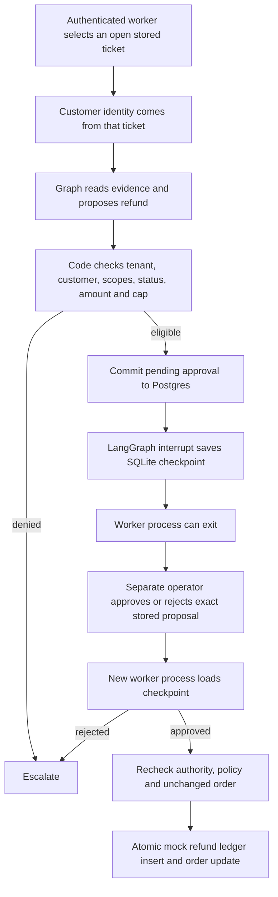

# Day 9: durable local approval workflow

SQLite remembers where the graph paused. Postgres holds the authoritative request,
operator decision and refund ledger. A resume value is a wake-up signal, never
permission. Only fictional orders and mock refunds are involved.

## What happens



The actual compiled graph is [approval-graph.mmd](approval-graph.mmd). In read-only
Day 8 mode, the approval remains a terminal placeholder and execute is unreachable.
Only DurableAgent binds the persistent approval/execution hooks.

The authoritative proposal binds tenant, run, order, amount, verified ticket
customer and worker identity. Both worker and approver credentials must still be
active with their required scopes at execution. They must be distinct principals.
Changing a proposal, order eligibility or the policy-relevant order snapshot
invalidates execution. The operator cannot raise the amount while approving.

Refunds use integer USD cents and the fixed $80 cap. For a full refund request
without an explicit amount, the durable graph proposes the stored order total;
the cap/ownership/status checks and human review still apply. Explicit zero or
negative amounts remain invalid. The decision is not delegated to the model.

Execution locks the approval and order, inserts a unique ledger row and updates
the order in one Postgres transaction. Repeating the same request returns its
existing receipt; a different run cannot refund that order again. This demo allows
one refund per order, including a partial refund, and then marks it refunded.
It does not implement repeated partial-refund accounting or real payments.

## Completed human-approved demo

The user explicitly approved the stored NW-T002 request, then ran resume:

- Run: `152af441-f371-43fd-9f01-b8626f8c9585`
- Order: **NW-1044**, customer NW-C002
- Amount: **7,500 USD cents ($75)**
- Decision: **approved**; order status: **refunded**; receipts: **exactly one**

Verified with a read-only local database query. See
[completion evidence](../evals/results/day-09-live-approved.json). The assistant
did not make the human decision or execute the demo. Earlier pending evidence
records the pause before the user's decision and remains preserved.

The commands below document the completed flow; do not approve the same request
again. Its decision is immutable. Automated operator simulations remain isolated
to copilot_test and did not authorize this demo.

## Exact operator commands

Use Windows PowerShell in **G:\support-copilot**. Docker's local Postgres and the
mock backend on 8004 must be running. Local schema and the two new role tokens
are already provisioned in this workspace; their values remain in ignored .env.

Review pending requests:

```powershell
.venv\Scripts\python.exe scripts/agent_workflow.py pending
```

After reviewing the exact order and amount, the human can explicitly approve:

```powershell
.venv\Scripts\python.exe scripts/agent_workflow.py approve --run-id 152af441-f371-43fd-9f01-b8626f8c9585
```

Or reject instead (choose one; a stored decision is immutable):

```powershell
.venv\Scripts\python.exe scripts/agent_workflow.py reject --run-id 152af441-f371-43fd-9f01-b8626f8c9585
```

Then resume from a new process, using the worker identity:

```powershell
.venv\Scripts\python.exe scripts/agent_workflow.py resume --run-id 152af441-f371-43fd-9f01-b8626f8c9585 --trace
```

Approved: status refunded, one fictional receipt. Rejected: escalation with
approval_rejected and no refund. Resuming while pending is rejected. Repeating a
completed resume does not duplicate execution. No model is called after this
approval pause. Keep the same local checkpoint file across terminal restarts.

To start another stored open ticket:

```powershell
.venv\Scripts\python.exe scripts/agent_workflow.py start --ticket-id NW-T001 --knowledge-url https://16-178-30-70.sslip.io --trace
```

A reply-only run ends without an approval. Inspect saved reasons if a model fails.
The Knowledge API hostname can change after an EC2 stop/start.

For a fresh local setup, initialize the schema/fixtures using the mock-backend
README, then provision distinct roles (trusted local admin commands):

```powershell
.venv\Scripts\python.exe -m support_copilot.cli provision-token --tenant northwind --scope kb:read --scope orders:read --scope tickets:read --scope agent:run --scope refunds:propose --scope refunds:execute --env-name NORTHWIND_WORKER_API_TOKEN
.venv\Scripts\python.exe -m support_copilot.cli provision-token --tenant northwind --scope refund:approve --env-name NORTHWIND_APPROVER_API_TOKEN
```

They write newly generated values only to .env and hashes to the selected database.
Use the default loopback database, never Neon for these local setup steps.

## Verification and trace evidence

- **291 tests passed**, including Postgres, rejection, forged resume values,
  expiry/revocation/scope loss, wrong tenant, changed order/proposal, duplicate
  refunds, amount checks and disabled default execution.
- [Restart evidence](../evals/results/day-09-approval-restart.json): independent
  start/resume processes, no model replay, unapproved execution blocked, one row
  after repeated resume. Uses an isolated random tenant, removed after testing.
- [Live pending evidence](../evals/results/day-09-live-pending.json): hosted model
  reached the durable pause using the real local backend and deployed retrieval.
- [Failed trace evidence](../evals/results/day-09-failed-trace.json): Langfuse read
  API verified an ERROR intake span with model_unavailable. This deliberate fake
  model error tests tracing; it does not explain Day 8 provider failures.

Tracing uses installed Langfuse 5.0.4; SQLite saver is 3.1.2, LangGraph 1.2.16.
Only node names and safe status/reason categories are exported. No prompts,
retrieved text, customer/order payloads, raw errors or credentials are sent.
Telemetry failures do not prevent or replay the operation. A separate root trace
is created per start/resume invocation; run state/authority lives in local stores.

The failed trace is available in the linked JSON's trace_url. Dashboard screenshot
is **not captured**: the Browser tool failed to initialize its local kernel assets.
Delivery and the failed node were verified through the read API, not a UI screenshot.
To capture it manually, open that URL while signed in and screenshot the ERROR
intake span; exclude settings/credential pages.

## Practical limits and next work

This is a trusted local operator CLI, with one process using SQLite at a time.
Both role credentials share the developer's .env, so distinct scopes are a demo
separation of principals, not isolated OS accounts or a production approval UI.
Protect the ignored checkpoint file; it contains fictional ticket/evidence data.
Run ids include tenant namespace, and resume verifies the caller's stored ownership.

Budgets reset the 120-second active-call timer after human wait; persisted steps
and reads remain bounded (durable workflow allows 12 nodes). No approval-expiry
policy or concurrent-worker load test is claimed. Postgres locks/constraints protect
the ledger, but SQLite orchestration is not a multi-worker deployment solution.

The local CLI uses the mock backend repository for transactional writes; the HTTP
POST /refunds remains 501. Day 10 must expose the same guarded write boundary to
the deployed internal backend, move checkpoints to Postgres, and run G2. No cloud
schema/deployment was changed, and the 25-case quality gate remains open.

References: [LangGraph interrupts](https://docs.langchain.com/oss/python/langgraph/interrupts),
[persistence](https://docs.langchain.com/oss/python/langgraph/persistence),
[Langfuse SDK](https://langfuse.com/docs/observability/sdk/overview).
