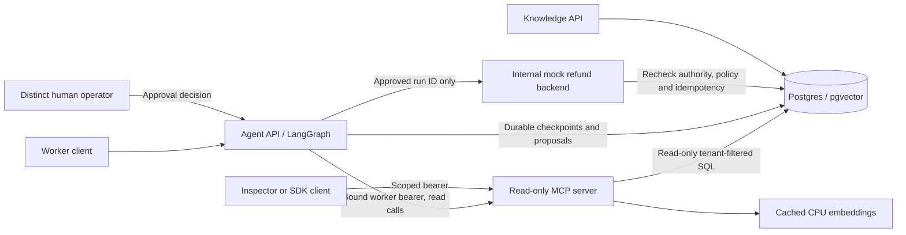

# CaseFlow architecture: Day 13 local integration

The graph's search_kb/get_order names are mapped to the MCP server's
search_knowledge_base/get_order_status names by the trusted MCPTools adapter.
It initializes the SDK client, discovers the fixed registry and checks strict
schemas and read-only annotations before calling. The model cannot provide a URL,
token, tenant, tool schema or new tool. The third MCP tool, list_open_tickets, is
available to external read clients but not added to the graph's model tool set.

The worker's incoming credential is forwarded only to the configured MCP service.
The server authenticates it independently on each request and read. Connections
remain stateless; there is no shared session authority. The adapter validates
structured outputs, bounds each complete RPC sequence to 20 seconds or the
remaining graph budget, bounds responses to 128,000 bytes and follows no redirect.
Unavailable or malformed MCP responses fail closed; there is no direct-read fallback.

Refunds are outside MCP. The distinct operator's decision, current worker/operator
permissions, order snapshot, policy and unique refund ledger still govern execution.
The internal backend accepts a run ID rather than model-supplied approval/amount.
LangGraph checkpoint durability does not confer permission.

## Verified local topology

| Component | Address | Exposure |
|---|---|---|
| Knowledge API | 127.0.0.1:8001 | Existing local service |
| Agent API | 127.0.0.1:8002 | Local worker/operator entrypoint |
| MCP | 127.0.0.1:8003/mcp | Local external clients; agent uses mcp-server:8000/mcp inside Docker |
| Mock backend | mock-backend:8000 | Docker network only |
| Postgres | 127.0.0.1:5432 | Existing local data volume |

The Compose project remains support-copilot to preserve ownership of its network
and volumes. Day 13 local containers use CaseFlow images. The EC2 deployment
remains the verified Day 10 release; the diagram is not proof of a public MCP
deployment. See [public deployment proposal](deploy-mcp.md).
